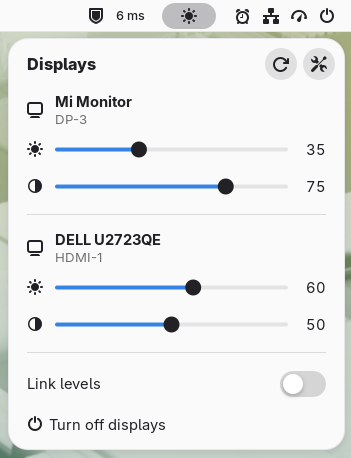

# Twinkle Tray for GNOME

A GNOME Shell extension (GNOME 48–50) that brings [Twinkle Tray](https://github.com/xanderfrangos/twinkle-tray)'s
core features to Linux:

<p align="center">
<picture>
  <source media="(prefers-color-scheme: dark)" srcset="screenshots/twinkle-tray-dark.png">
  
</picture>
</p>

| Twinkle Tray (Windows)                                 | Here                                                              |
|--------------------------------------------------------|-------------------------------------------------------------------|
| Brightness slider per monitor (DDC/CI VCP 0x10)        | Panel menu with a brightness slider per monitor                   |
| Contrast (VCP 0x12)                                    | Contrast slider per monitor (can be hidden in Settings)           |
| Link levels                                            | "Link levels" switch (shown with two or more monitors)            |
| Scroll on the tray icon                                | Scroll on the panel icon adjusts all monitors, with the GNOME OSD |
| Hotkeys                                                | Shortcuts for brightness up/down and turning displays off         |
| Update rate                                            | Same setting: how often monitors follow a moving slider           |
| Turn off displays (`SC_MONITORPOWER`, wakes on input)  | Mutter power-save → off, back on at the next key press/mouse move |

## Requirements

- `python3` (installed by default on Fedora)
- The `i2c-dev` kernel module and read/write access to `/dev/i2c-*` (be in the `i2c` group)
- DDC/CI enabled in the monitor's on-screen menu

`ddcutil` is **not** needed (it's still handy for diagnosis: `ddcutil detect`).

## Install

```sh
git clone https://github.com/ajshovon/gnome-twinkle-tray.git
cd gnome-twinkle-tray
./install.sh
```

Then log out and back in: GNOME Shell on Wayland only loads new extension code at login.

## Why it's fast

Changing a monitor's brightness means talking DDC/CI over the GPU's I²C bus. On NVIDIA's driver
every I²C transfer busy-waits **~25 ms in the kernel**, and while it does the desktop stalls.
Measured on an RTX 3060:

| Approach                                       | I²C transfers | Kernel time |
|------------------------------------------------|---------------|-------------|
| `ddcutil getvcp 10` (one read)                 | 11            | ~285 ms     |
| `ddc-helper.py` read                           | 2             | ~50 ms      |
| `ddc-helper.py` write                          | 1             | ~26 ms      |

So the extension:

- runs one long-lived helper (`ddc-helper.py`) that speaks DDC/CI directly and is spawned once,
  instead of forking `ddcutil` from gnome-shell for every change;
- finds monitors via sysfs and the kernel's cached EDIDs, probing I²C only once per port;
  re-detection after hotplug or wake costs no I²C traffic at all;
- never reads the monitor when the menu opens: values are cached (re-read only on *Refresh*,
  or 10 minutes later, after the menu closes);
- throttles writes while you drag like Twinkle Tray's update rate (250 ms by default), skips
  values the monitor already has, and lets the helper merge whatever queues up.

In a headless test shell, dragging a slider went from 49 fps with 222 ms frame gaps to a steady
60 fps (worst gap 19 ms), and opening/closing the menu from 29 fps to 60 fps.

## Notes

- **Turn off displays** blanks every output through Mutter (what GNOME does on idle). It doesn't
  lock the screen. A short delay (default 500 ms) lets you release the mouse/keys first.
- The extension stays loaded on the lock screen (icon hidden) only so a pending wake-on-input still
  fires if the session locks while the displays are off.
- Laptop panels are left to GNOME's own brightness slider.

## Troubleshooting

Run the helper by hand to see exactly what it does on the bus:

```sh
echo '{"id":1,"op":"refresh"}' | TWINKLE_TRAY_DEBUG=1 \
    python3 ~/.local/share/gnome-shell/extensions/twinkle-tray@local/ddc-helper.py
```

Extension messages: `journalctl --user -b | grep -i twinkle`

## License

[GPL-3.0-or-later](LICENSE)

Not affiliated with the original [Twinkle Tray](https://github.com/xanderfrangos/twinkle-tray) project; this is an independent GNOME implementation inspired by it.
